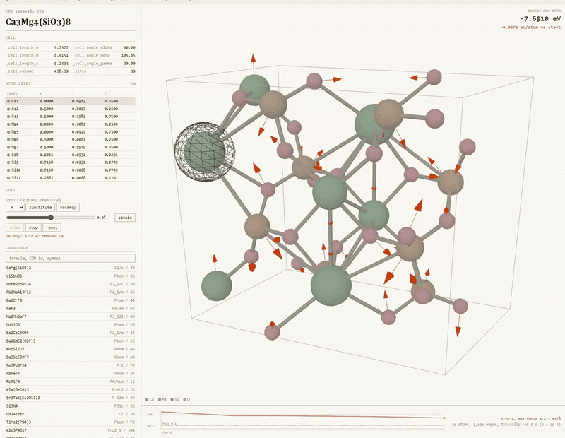

# anneal

Edit a real crystal structure and watch a machine-learned potential relax it, one step at a time.

[](https://github.com/markolivaic/anneal/actions/workflows/ci.yml)

anneal runs **CHGNet**, a pretrained universal interatomic potential, on crystal
structures from the **Crystallography Open Database**. Load a structure,
substitute an atom, pull out a vacancy or strain the cell, and press relax. Every
optimizer step streams to the browser as it is computed: the force trace
descends, the energy moves, the atoms shift. The relaxation is the animation, not
a wait before one. It is real, it uses 412,525 pretrained parameters, and it runs
on your CPU with no GPU.

## What this is NOT

CHGNet is an **approximation to DFT. It is not DFT.** The energies here are for
comparing structures of one composition: a strained cell against the deposited
one, or the start of a relaxation against its end. They are **not
publication-grade**, not benchmark labels, and not interchangeable with DFT
numbers. Nothing here was trained: the weights are the published ones, used as
published.

anneal does not offer all of COD. In a uniform random sample of 4,000 entries,
**27.8%** passed the filter (95% CI 26.5-29.2), which projects to roughly 147,000
of the **528,181** entries COD's default search returns. Two things do nearly all
of the cutting, and only one of them is about the model:

- **Cell size.** 62.6% of parsed entries hold more than 150 atoms. That is this
  project's CPU budget, not a limit of CHGNet.
- **Disorder.** 30.9% carry partial or mixed site occupancy. CHGNet needs one
  element on each site and raises an error on a mixed one, so anneal refuses
  them before they reach it. That one is the model.

Hydrogen that the diffraction never located removes 1.8% more. CHGNet would
take those without complaint: a structure missing its hydrogen is still a valid
input, and the number that comes back describes a different compound. Nothing
in this sample was rejected for element coverage, though the catalogue build
rejected 6 of 12,000 on CHGNet's Z ≤ 94 bound. The limit is real, it is just rare.

## Walkthrough

[](docs/walkthrough/app-walkthrough.mp4)

[Full-resolution H.264 recording](docs/walkthrough/app-walkthrough.mp4), and the
[poster frame](docs/walkthrough/app-walkthrough-poster.jpg).

One uninterrupted recording of the running application. It loads diopside from
the catalogue, removes one calcium site, and relaxes the result. The vermilion
arrows are the forces CHGNet is predicting, and they shrink as the trace at the
bottom descends. That run converged in 30 steps at a maximum force of
0.071 eV/A. Every state transition is rendered by the running application. No
screen is mocked.

## Why this exists

A universal interatomic potential is 412,525 parameters and runs a relaxation on a
laptop CPU. I wanted to see whether that is enough to make crystal structures
something you poke at rather than read about.

Getting the model running took an afternoon. Then I pointed it at real COD
entries and most of them were not structures a potential can read: partial
occupancies, disordered sites, hydrogen the X-rays never located. CHGNet does not
error on any of that. It takes the input and returns a confident number that
means nothing, which is worse than failing. So the first thing built here was not
the viewer, it was `scripts/survey_cod.py`, which measures how much of COD
survives a filter. The answer decides what the project may honestly claim, and it is above,
not buried at the bottom.

Two findings changed the design, and both are in the tests so they cannot quietly
stop being true:

**A vacancy in a small cell is not an isolated vacancy.** Remove a sodium from
the 8-atom rocksalt NaCl cell and the maximum force is below 10⁻⁵ eV/Å. I spent an
hour treating that as a bug, because taking an atom out of a lattice obviously
has to pull on its neighbours. In a periodic cell the vacancy repeats in every
image of the cell, here 5.62 Å apart, so the edit describes an ordered Na₃Cl₄
compound in which every remaining site still sits at an inversion centre, where
forces vanish. In a 64-site supercell the images are 11.24 Å apart, and each of
the six neighbours of the vacancy is pushed with 0.28 to 0.31 eV/Å. So a
substitution or a vacancy is made in the smallest supercell whose periodic
images are at least 10 Å apart, within the 150-atom budget, and refused when
none fits. Relaxations in the interface move the atoms inside a fixed cell.

**Cost is governed by graph edges, not atom count.** A 66-atom molecular crystal
and an 88-atom oxide have 5,418 and 5,424 edges and cost 551 and 452 ms per step:
the cell with a third more atoms is not the slower one. CHGNet's message passing
runs per edge. Over the 7 structures in `data/benchmark.json`, a straight line in
edges gives R² 0.958 for the cost per step and a line in atoms
gives R² 0.845. The edge fit is what the interface uses to
tell you how long a relaxation will take before you start it.

## How it works

```
COD REST  ──▶  filter  ──▶  catalogue  ──▶  viewer  ──▶  edit  ──▶  relax (SSE)
              (7 stages)     8,321          three.js    geometry    one event
                             structures                  only        per step
```

| File | Responsibility |
|---|---|
| `backend/anneal/cod.py` | COD REST, the on-disk CIF cache, the sampling frame |
| `backend/anneal/filters.py` | the seven-stage filter; `evaluate()` is the predicate |
| `backend/anneal/mutations.py` | substitute / vacancy / strain and the defect supercell; pure geometry, no model |
| `backend/anneal/relax.py` | CHGNet single-point and relaxation with per-step callbacks |
| `backend/anneal/api.py` | HTTP surface; `POST /api/relax` streams one SSE event per step |
| `web/src/viewer.js` | unit cell, atoms, bonds, force vectors in three.js |
| `web/src/trace.js` | the force-convergence trace |
| `web/src/elements.js` | the palette rule, with a runtime assertion enforcing it |
| `scripts/survey_cod.py` | the survival rate and its funnel |
| `scripts/build_catalog.py` | the browsable catalogue |
| `scripts/benchmark.py` | every timing number below |
| `scripts/validate_against_experiment.py` | how far a relaxed cell lands from the measured one |

The relaxation loop is written directly on ASE rather than using CHGNet's
`StructOptimizer`, which builds its optimizer internally and exposes no per-step
hook. Without that hook there is no live trace, and the live trace is the point.

**Why CHGNet.** On Matbench Discovery, a benchmark of crystal stability
prediction, CHGNet scores F1 0.613. MACE-MP-0, trained on the same data, scores
0.669, and MatterSim v1 5M and ORB v3, trained on other and larger data, score
0.862 and 0.905 (leaderboard on 2026-10-31, unique-prototype test set). CHGNet
is used here for its size: 412,525 parameters, against 4.55 to 25.5 million for
the other three, and a relaxation in this interface has to finish on a CPU while
someone watches it. It also has a documented bias. Deng et al. (2025) found that
CHGNet, M3GNet and MACE-MP-0 systematically underpredict the curvature of the
potential energy surface, so their energies and forces come out too small.

**One structural idea in the interface:** the page is a single entry from a
reference volume: a ruled two-column spread where the left column is the
structure as *record* (cell constants and a site table in the CIF's own tag/value
texture) and the right column is the same structure as *geometry*. You edit in
the record column; the geometry column answers.

**One colour rule, which is also the honesty mechanism:** *hue distinguishes
species, saturation marks provenance.* Elements are given hue at a single fixed
low chroma, so they read as tinted greys. Vermilion is the only saturated thing
on the page. It marks what CHGNet produced (the force vectors, the energy delta,
the trace) and the one site you edited, which is no longer the deposited record.
Controls, messages and the edit history are ink. `assertPaletteDiscipline()`
fails loudly if an element's chroma is ever raised toward the accent.

Type is Libertinus Serif, which descends from Linux Libertine, with IBM Plex Mono
for tags and numbers. Both are bundled from `@fontsource`, so the page does not
depend on the fonts a reader has installed.

The browser side is plain JavaScript on Vite with three.js and nothing else. One
route, one canvas, and an animation loop that owns the frame. A reconciler would
sit between this code and the renderer without earning its place.

## Quick start

Two processes: the Python API and the web dev server.

```bash
git clone https://github.com/markolivaic/anneal && cd anneal
python -m venv .venv && . .venv/bin/activate   # Windows: .venv\Scripts\activate
pip install torch --index-url https://download.pytorch.org/whl/cpu
pip install -e "backend[model,dev]"
```

```bash
python -m uvicorn anneal.api:app --port 8000
```

```bash
cd web && npm ci && npm run dev
```

Open <http://localhost:5173>. The catalogue ships in `data/catalog.csv`, so there
is nothing to download first and no API key anywhere in this project.

To regenerate the data instead of trusting the committed copies:

```bash
python scripts/survey_cod.py --sample-size 4000 --seed 20260806
python scripts/build_catalog.py --max-fetch 12000
python scripts/benchmark.py
python scripts/validate_against_experiment.py --sample-size 200 --seed 20260814
```

The last one relaxes 200 structures. In the committed run those relaxations add
up to 11.6 hours on the machine below, and each worker process holds about
1.2 GB, so `--workers` is limited by memory as much as by cores. It writes each
row as it goes and takes `--resume`, so an interrupted run continues instead of
starting over.

The first `pip install` takes torch's CPU wheel. Without it, pip on Linux
resolves torch to the CUDA build and its `nvidia-*` dependencies, several GB for
a project that never uses a GPU. `pip install -e "backend[dev]"` without `model`
skips CHGNet and torch entirely. The survey, the filter and every test in
`tests/integrity` run fine without them; relaxation does not.

## CLI

```bash
python scripts/fetch_cod.py 1000041 9016675 4124645
```
```
1000041  OK       Na4 Cl4  [8 sites, 2 primitive, 177.5 A^3]
9016675  OK       Fe12 C4  [16 sites, 16 primitive, 155.2 A^3]
4124645  REFUSED  size_within_limit: 288 sites > 150

2/3 accepted at max_atoms=150
```

A refusal names the stage that produced it. `scripts/fetch_cod.py` also abandons
any CIF over 4 MB before downloading it in full and reports that separately.
COD stores structure-factor blocks inside some files, and the largest in a
4,000-entry sample was 48.6 MB against a median of 19.6 KB.

## Verification

Measured on an AMD Ryzen, 16 threads, CPU only: the survey and catalogue on
2026-08-07, the benchmark and the validation on 2026-10-31. Rerun anything here.

| Check | Command | Result |
|---|---|---|
| Behavioural tests: 83 | `pytest tests/unit` | 83 passed |
| Palette tests (JS): 12 | `cd web && npm test` | 12 passed |
| Integrity tests: 8 | `pytest tests/integrity` | 8 passed |
| Lint | `ruff check backend scripts tests` | clean |
| Format | `ruff format --check backend scripts tests` | clean |
| COD survival rate | `python scripts/survey_cod.py` | 27.82%, 95% CI 26.46-29.23 |
| Catalogue size | `python scripts/build_catalog.py` | 8,321 kept of 12,000 fetched |
| Model parameters | `python scripts/benchmark.py` | 412,525 (412,431 trainable) |
| Cost model fit | `python scripts/benchmark.py` | R² 0.958 on graph edges, 7 structures |
| Distance from experiment | `python scripts/validate_against_experiment.py` | +8.05% median cell volume error, n=193 |

Counts are split on purpose. The integrity tests compare the numbers in this
README with the committed files they come from, such as
`data/survey_cod_summary.json`. They say nothing about whether the code is correct
and are never added to the behavioural total.

### How wrong is it

"Approximation to DFT" is a caveat, not a measurement.
`scripts/validate_against_experiment.py` relaxes 200 catalogued structures with
the cell free and compares the result against the cell the crystallographer
measured. A run counts as converged when every force is below 0.02 eV/Å and
every stress component below 0.1 GPa. 193 converged, and 7 hit the 1,000-step
ceiling and are reported separately.

The relaxed cell is **+8.05%** larger than the deposited one at the median, 95%
CI +6.62 to +8.73, with a median absolute error of 8.07% and a mean of +9.23%.
184 of 193 cells came out larger than measured and 9 smaller, and 75 are off by
more than 10%.

| measurement temperature | n | median volume error | contains carbon | median sites |
|---|---:|---:|---:|---:|
| under 150 K | 39 | +11.12% | 33 | 72 |
| 150 to 250 K | 35 | +11.24% | 33 | 72 |
| over 250 K | 61 | +8.01% | 45 | 64 |
| not recorded | 58 | +4.68% | 5 | 28 |

A temperature bin is a population, not a controlled variable, which is why the
last two columns are in the artifact. The three bins with a recorded temperature
are 74 to 94% carbon-containing molecular crystals of around 70 sites. The
unrecorded bin is 9% carbon and half the size, because modern single-crystal
refinements log a temperature and older inorganic entries mostly do not. So the
split sorts by chemistry as much as by temperature, and what it shows is that the
molecular crystals swell most, by about 11%, and the mostly inorganic entries by
about 5%. MPtrj, the data CHGNet was trained on, comes from PBE and PBE+U
calculations without a dispersion correction, and PBE without one underbinds crystals held
together by van der Waals forces, so this is the direction to expect. The bin
over 250 K sits about 3 points below the two colder ones. Thermal expansion of
the measured cells pushes that way, but that bin also holds fewer molecular
crystals, and this sample cannot separate the two.

The convergence test matters more than it looks. ASE's `FrechetCellFilter`
divides the cell gradient by the number of atoms by default, so a force
criterion alone lets a relaxation stop with the cell still under substantial
stress. The threshold here is stated in GPa and checked directly. Within it, a
molecular crystal with a bulk modulus near 10 GPa can still sit about 1% from its
own minimum.

Five converged entries were measured in a pressure cell, at 0.17 to 10.8 GPa
according to their CIFs, and are relaxed here at zero pressure, so their errors
are not the model's alone. The clearest is AgCl (COD 9011678), the phase III
structure at 10.8 GPa, which comes out 30.2% larger. Leaving all five out moves
the median from +8.05% to +8.03%. The largest error, +76.5%, is a copper(I)
bromide coordination polymer (COD 4321511), and the most negative, -39.1%, is
solid helium at 0.17 GPa.

Two things this is not. The reference is a diffraction measurement, so the
figure is CHGNet's distance from **experiment**, which is not its error against
the DFT-PBE data it was trained on. And it measures geometry only: the energies
anneal displays have no experimental counterpart here, so a cell landing close
to the measured one says nothing about whether an energy difference is right.
`data/validation_summary.json` records ten limitations alongside the numbers.

Timings from `data/benchmark.json`:

| atoms | graph edges | single point | steps | ms/step | full relax |
|---:|---:|---:|---:|---:|---:|
| 2 | 128 | 75 ms | 5 | 69 | 0.3 s |
| 36 | 2,280 | 218 ms | 40 | 248 | 9.9 s |
| 66 | 5,418 | 520 ms | 62 | 551 | 34.1 s |
| 88 | 5,424 | 424 ms | 31 | 452 | 14.0 s |
| 106 | 8,048 | 636 ms | 57 | 697 | 39.7 s |
| 124 | 10,104 | 847 ms | 66 | 826 | 54.5 s |
| 150 | 14,244 | 1,181 ms | 53 | 1,505 | 79.8 s |

## Limitations and failure modes

- **The measured +8.05% is geometry, and only against experiment.** It says
  where a relaxed cell lands relative to a diffraction measurement. It is not
  CHGNet's error against the DFT data it was trained on, and it is not evidence
  about the energies this tool displays, which have no experimental counterpart
  to be checked against. A cell close to the measured one can still sit on a
  wrong energy difference.
- **The energies are not DFT.** CHGNet is trained on DFT and approximates it.
  The readout shows a difference only between structures of one composition,
  against the deposited cell or across one relaxation. Comparing compositions,
  as a substitution or a vacancy does, needs reference energies for the atoms
  added or removed, which anneal does not have.
- **Relaxations at the top of the range take more than a minute.** A 150-atom
  cell took 79.8 s over 53 steps here, starting from atoms displaced by 0.05 Å.
  It streams, so you watch it rather than wait for it, and the stop button always
  works and keeps every step already computed.
- **Missing hydrogen is only caught when the CIF admits it.** The filter compares
  the declared formula against the atom sites. An entry that omits hydrogen from
  *both* is invisible to it. Among the 1,113 survivors in the sampled set, 10
  contain carbon and no hydrogen at all, and every one of those ten is genuinely
  hydrogen-free (WC, Fe₃C, CeB₂C, fluorinated graphite, carbonates, cyanides),
  but the rule cannot prove that in general. A ratio-based version
  that tried to catch partial hydrogen loss was tested and dropped: on 548 entries
  it caught zero cases the simple rule misses and produced false positives.
- **The catalogue is not a random sample and its size is not a survival rate.**
  `data/catalog.csv` comes from a volume-bounded COD query (under 1500 ų, 95%
  precision and 92.3% recall for cells of 150 atoms or fewer), because a uniform
  sample spends most of its requests on cells too large to offer. The 27.8% above
  is the uniform-sample number and the only one that describes COD.
- **Symmetry labels may disagree with the depositor.** They are recomputed from
  coordinates at 0.1 Å tolerance.
- **The size filter uses the deposited cell, not the primitive cell.** Filtering
  on primitive cells would admit more structures, but the viewer shows the
  deposited cell and an edit has to map to what is on screen.
- **The frame is 528,181 of COD's stated 534,673.** The difference is 5,416
  duplicates, 9 error-flagged and 1,004 theoretical entries that COD's default
  search excludes; 46 are returned by no query I tried.
- **Timings are from one machine.** Rerun `scripts/benchmark.py` and the table
  and the in-app estimate both become yours.

## References

- Deng et al., *CHGNet as a pretrained universal neural network potential for
  charge-informed atomistic modelling*, Nature Machine Intelligence 5,
  1031-1041, 2023.
- Deng et al., *Systematic softening in universal machine learning interatomic
  potentials*, npj Computational Materials 11, 9, 2025.
- Riebesell et al., *A framework to evaluate machine learning crystal stability
  predictions* (Matbench Discovery), Nature Machine Intelligence 7, 836-847, 2025.
- Batatia et al., *A foundation model for atomistic materials chemistry*
  (MACE-MP-0), arXiv:2401.00096.
- Yang et al., *MatterSim: A Deep Learning Atomistic Model Across Elements,
  Temperatures and Pressures*, arXiv:2405.04967.
- Neumann et al., *Orb: A Fast, Scalable Neural Network Potential*,
  arXiv:2410.22570.
- Gražulis et al., *Crystallography Open Database: an open-access collection of
  crystal structures*, J. Appl. Cryst., 2009.
- Bitzek et al., *Structural relaxation made simple* (FIRE), Phys. Rev. Lett., 2006.

These references motivate the design; they do not validate the numbers here.
Those come from the scripts in `scripts/`.

## License

MIT. See [LICENSE](LICENSE). Third-party data and model attribution is in
[THIRD_PARTY_NOTICES.md](THIRD_PARTY_NOTICES.md). COD content is public domain;
CHGNet is Modified BSD.
